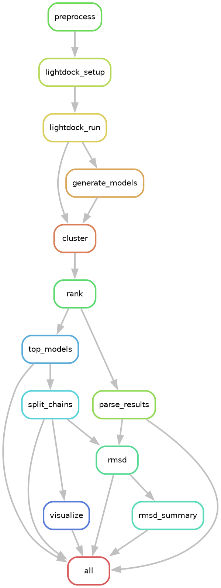
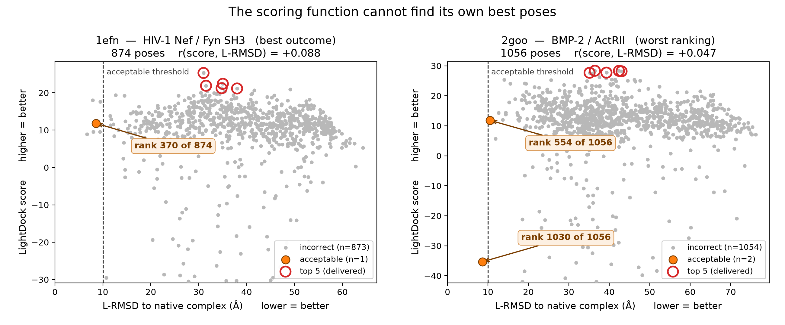

# Protein–protein docking with Snakemake

A Snakemake workflow that docks pairs of proteins with
[LightDock](https://lightdock.org/) and checks the predicted complexes against
the experimental structures.

For each pair, the inputs are two **unbound** structures (receptor and ligand,
PDB format). The outputs are the best-scoring poses, their scores, an image, and
their distance from the native complex.

## How it works

| Step | Rule | What it does |
|---|---|---|
| 1 | `preprocess` | Cleans the structures with PDBFixer: removes heterogens, adds missing residues, atoms and hydrogens (pH 7) |
| 2 | `lightdock_setup` | Places swarms of ligand copies ("glowworms") around the receptor |
| 3 | `lightdock_run` | Runs the docking: glowworms move towards better-scoring neighbours |
| 4 | `generate_models` | Writes a PDB file for each glowworm |
| 5 | `cluster` | Removes near-duplicate poses within each swarm |
| 6 | `rank`, `top_models` | Ranks the poses of all swarms and extracts the top N |
| 7 | `split_chains` | Writes the receptor as chain R and the ligand as chain L |
| 8 | `parse_results`, `visualize` | Produce the score table, the score plot and a PyMOL image |
| 9 | `rmsd`, `rmsd_summary` | Compare the poses with the native complex |



## Usage

Requires conda and Snakemake 8 or later. Snakemake creates the environments in
`envs/` by itself.

```bash
snakemake -n                       # dry run: list the jobs
snakemake --cores 16 --sdm conda   # run the workflow
```

Pairs and docking parameters are set in `config/config.yaml`. The defaults
(5 swarms, 100 glowworms, 10 steps) are a quick run. A pair without a `native`
entry is docked but skips the RMSD steps.

## Output

| File | Content |
|---|---|
| `results/{pair}/complex/top_{n}.pdb` | Top N poses (chains R and L) |
| `results/{pair}/analysis/scores.csv`, `top_scores.png` | All ranked poses; plot of the 20 best scores |
| `results/{pair}/analysis/top_1.png` | Image of the best-scoring pose |
| `results/{pair}/analysis/rmsd.csv`, `rmsd.png` | Comparison with the native complex |
| `results/rmsd_summary.csv` | One row per pair |

Pose quality uses the [CAPRI](https://www.capri-docking.org/) criteria: L-RMSD and I-RMSD (lower is better),
`fnat` (fraction of native contacts recovered) and
[DockQ](https://doi.org/10.1371/journal.pone.0161879) (0 = wrong, 1 = perfect).

## Results

Run with 100 swarms × 100 glowworms × 100 steps, evaluating every clustered pose.
"Best possible" is the positive control: each unbound protein superposed on its
native chain. The 2g45 pair is not included in these results.

| Pair | Complex | Best possible DockQ | Best DockQ found | Rank of that pose | Acceptable poses |
|---|---|---|---|---|---|
| 1efn | HIV-1 Nef / Fyn SH3 | 0.878 | 0.256 | 38 / 874 | 1 |
| 2goo | BMP-2 / ActRII | 0.749 | 0.282 | 1030 / 1056 | 2 |
| 3fap | FKBP12 / FRB | 0.801 | 0.308 | 99 / 987 | 2 |

- **Ranking is the clearest problem.** Docking finds a few acceptable poses for
  each of the three pairs, but none reaches the top 5.
- **The score does not identify good poses.** Its correlation with L-RMSD is close
  to zero (r = 0.05–0.11); a useful score would give a clearly negative value.
- **Sampling is also limited.** At most 2 poses per pair are acceptable, far below
  the best possible quality.



Limitations:

- **3fap:** binding is mediated by rapamycin, which preprocessing removes.
- Results come from one run per pair, with no replicates.

## Tests

In an environment built from `envs/rmsd.yaml`:

```bash
python -m pytest tests/
```
